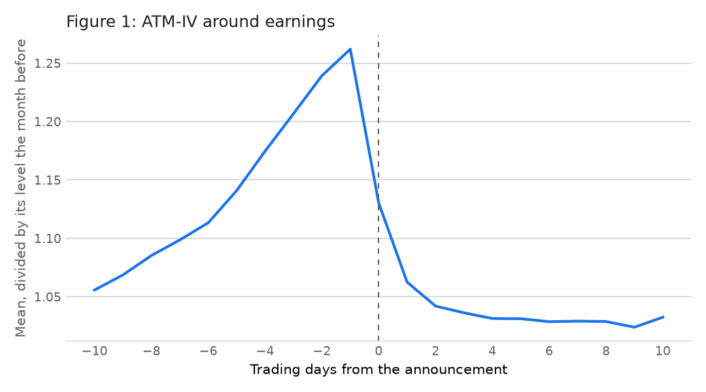

# Asymmetric Uncertainty Around Earnings Announcements, recreated for NSE stock options

This study recreates, from free NSE data, the reproducible part of Saurav, Agarwalla and Varma (2024), *Asymmetric Uncertainty Around Earnings Announcements: Evidence from Options Markets*, American Business Review 27(2), 459-487, [doi:10.37625/abr.27.2.459-487](https://doi.org/10.37625/abr.27.2.459-487).

The paper studies Indian single-stock options around the quarterly earnings announcements of firms with stock derivatives, from January 2015 to December 2019. It looks at:
- implied volatility (IV) at the money and across the smile;
- the skew, measured as a risk reversal (RR-IV, the IV at call delta 0.25 minus the IV at delta 0.75);
- three volume ratios: options to stock (O/S), options to futures (O/F) and puts to calls (P/C).

It then asks whether the skew and P/C on the days before an announcement predict the sign of the earnings surprise.

The paper used paid tick data, Prowess and IBES. This recreation builds every measure from NSE's public daily files instead: the F&O and equity bhavcopies, results filings and the announcement feed. It uses the standardised unexpected earnings (SUE) as the only surprise measure.

**In one line:** the options market does anticipate the earnings surprise. The skew the day before correlates 0.163 with SUE (the paper: 0.162), and RR-IV and P/C are significant at the 1% level in the paper's regression. But the stock price has already absorbed this by the close of day -1, so trading it loses money even before costs, and the effect is weaker after 2019.



**Interactive companion:** a paper-style page with every table and chart will be at https://tradingmachine.co.in/papers/saurav-agarwalla-varma-earnings-options-skew-india/ once it is published.

## Headline results, 2015-2019

| | This study | Paper |
|---|---|---|
| Events (firm-quarters) | 2,072 | 2,081 |
| ATM-IV, EA month minus the month before (Table 5) | +0.026 (t 6.44) | +0.028 (t 6.70) |
| O/S on day 0, peak (Figure 4) | 1.97 | about 1.63 |
| Correlation of RR-IV on day -1 with SUE (Table 4) | 0.163 | 0.162 |
| Correlation of P/C on day -1 with SUE (Table 4) | -0.169 | -0.110 |
| RR-IV on day -1, coefficient on SUE (Table 6, column 2) | 3.23*** | 2.51*** |
| P/C on day -1, coefficient on SUE (Table 6, column 2) | -0.81*** | -1.15*** |
| ATM-IV on day -1, coefficient on SUE (Table 6, column 2) | -0.39 (not significant) | 0.42 (not significant) |
| Long-short futures on the day -1 skew, day -1 close to day 0 close, per trade before costs | -0.21% (1,402 trades) | not tested |
| The same trade, annual after Indian costs (Newey-West t, worst drawdown) | -2.8% (-3.04, -13.8%) | not tested |

Stars mark significance at 1% (\*\*\*), 5% (\*\*) and 10% (\*), from classical standard errors as in the paper. With standard errors clustered by firm, RR-IV and P/C stay significant (t 2.29 and -3.41).

## What the Indian data says

1. **Uncertainty builds up before earnings and is resolved by them.** ATM-IV rises steadily from day -10 to day -1, 26% above its level in the month before, and drops sharply on day 0. IV at deltas 0.25 and 0.75 does the same. In the announcement month IV is 0.026 to 0.034 higher than in the months either side.
2. **Option trading surges into the announcement.** O/S and O/F peak on day 0 at 1.97 and 0.80, against 1.21 and 0.43 ten days before.
3. **The skew and the put-to-call ratio forecast the surprise; the level of IV does not.** Before the worst third of surprises, RR-IV falls to -0.017 on day -1 and P/C rises to 0.60 on day 0. ATM-IV rises in the same way whatever the surprise.
4. **Days -2 and -3 are less clear-cut than the paper says.** In the main run RR-IV also predicts SUE on days -2 and -3 (coefficients 3.34 and 2.66), where the paper finds nothing. But this does not survive the stricter or looser liquidity filters, so it does not overturn the paper's finding that the signal appears on day -1.
5. **Liquidity matters.** Requiring at least 20 contracts a day strengthens the skew result (RR-IV 4.7, t 3.3). Allowing thinly traded options weakens it (1.4, t 1.6). This is what noise from daily closes would do.
6. **It is not a trade.** The day -1 skew predicts the accounting surprise, but not the next day's price move. It even points slightly the wrong way (rank correlation -0.05), because the price has already moved. A long-short stock-futures trade on RR-IV, P/C or both loses 0.17-0.29% per trade before costs. A round trip costs about 0.29%.
7. **After 2019 the effect fades.** In January 2020 to March 2025:
   - options volume is five times larger relative to stock volume;
   - IV still jumps into earnings;
   - RR-IV no longer predicts SUE (t 1.0) and P/C only weakly (t -1.8).

## The paper in brief

**Hypotheses.** The options market reflects uncertainty about earnings, and asymmetric uncertainty, and informed traders use options, so:
- IV and the skew rise into an announcement and fall after it;
- option volume rises against stock and futures volume;
- RR-IV and P/C on the days just before predict the sign of the surprise.

**Method.**
- **Smiles.** A quadratic smile in call delta is fitted each stock-day to time-matched option and futures trades (Black 1976).
- **Events.** Exact broadcast times date the events.
- **Surprise.** SUE uses a seasonal random walk with drift. The paper also uses IBES analyst surprises.
- **Regression.** The surprise is regressed on RR-IV, P/C and ATM-IV on day -n, with firm and year-quarter fixed effects and controls.

**Findings.** All three hypotheses hold, but only one day before the announcement (pages 475-481).

## What was changed for India, and why

The paper is already Indian. The changes replace paid data with free data.

| Item | Paper | Here | Why |
|---|---|---|---|
| Option and futures prices | Time-matched trades (NSE tick data) | Daily bhavcopy closes; the forward is the same expiry's futures close | Tick data is paid. Closes are not synchronous, so RR-IV is an approximation |
| Liquidity filter | Traded for at least five minutes | At least five contracts traded that day (1 and 20 as sensitivity) | No intraday data |
| Event time | NSE announcement pages | NSE's announcement feed ('Financial Result Updates') | The results API's time is the structured filing, up to 576 days late |
| EPS for SUE | Prowess | NSE results filings: standalone, HTML before mid-2018 and XBRL after, adjusted for splits and bonuses | Free |
| IBES surprise, coverage, dispersion | IBES | Dropped | No free source |
| Institutional holding | Prowess | Dropped | No free history for 2015-2019 |
| Returns, beta, momentum, size, BHAR | Prowess | NSE equity bhavcopy with corporate actions; NIFTY 500 total-return index; shares from paid-up capital | Free |
| Risk-free rate | RBI 91-day T-bill | IIMA's monthly RF | Not in UBI |

## Data

All raw data are NSE files, kept out of the repository; `data/README.md` lists every file with its counts.

| Source | Period | Use |
|---|---|---|
| NSE F&O bhavcopy, old format and UDiFF | 2009 to 2025, 5,387 files | Smiles, volume ratios, futures returns |
| NSE equity bhavcopy | 2009 to 2025 | Stock returns, turnover, prices |
| NSE corporate actions | 2000 to 2026 | Splits, bonuses and dividends |
| NSE financial results API, and 13,032 results filings | Broadcasts 2010 to Apr 2025 | EPS, face value, paid-up capital |
| NSE corporate announcements | 2014 to 2025, 505 symbols | True announcement times |
| niftyindices.com | 1995 to 2026 | NIFTY 500 total-return index |
| IIMA four-factor file | 1993 to 2025 | Risk-free rate |
| UBI (tradingmachine) | Dec 2019 to Oct 2026 | Cross-check only; UBI has no expired options or futures (gap 36) |

**What is missing:**
- 340 filings have no link on NSE (mostly 2018), which costs SUE coverage: 1,275 events against the paper's 1,831.
- There is no shareholding history for 2015-2019.
- Delisted shares are included, because NSE's own files keep them.

## Detailed results

See `results/summary.md` for every reproduced table with the paper's numbers beside it, the trading test, the extension and the sensitivity analysis. Also:
- `results/main/comparison.md` and `results/extension_2020_2025/comparison.md` are generated side-by-side tables;
- `results/*/figures/` holds the charts;
- `results/review/review.md` is the independent review of the trading test.

## Caveats

- **RR-IV is built from daily closes, not time-matched trades.** The level and the event pattern match the paper closely, but the noise is different.
- **SUE needs 20 quarters of history.** Gaps in NSE's 2018 filings remove about a third of the paper's SUE sample.
- **Several of the paper's choices are not stated,** and the study had to pick one for each:
  - standard errors;
  - the kind of R²;
  - P/C units;
  - the smile-fit objective.

  They are documented in `.claude/notes/` and tested in the sensitivity table. The paper's Table 3 P/C mean (0.124) disagrees with its own Figure 5 (0.44-0.56); ours matches the figure.
- **Variants tried.** One main specification was fixed in the plan before any result was seen. Sensitivity variants are counted in `results/summary.md`: contracts filter, settle prices, premium-error fit, P/C in value, and an alternative SUE. The trading test was run as 3 signals × 2 periods × 2 cost settings. None was chosen for its result.
- **Momentum and other controls behave differently from the paper.** Momentum strongly predicts SUE here.

## Reproducing the results

```bash
python3.14 -m venv .venv
.venv/bin/pip install -e ".[test,figures]"
.venv/bin/pip install -e ~/Projects/data-and-analytics --no-deps
.venv/bin/pytest -q

S=src/saurav_agarwalla_varma_asymmetric_uncertainty_india/scripts
# Raw NSE files go in data/nse (see data/README.md), then:
.venv/bin/python $S/build_derived_stores.py
.venv/bin/python $S/build_futures_ranges.py
.venv/bin/python $S/download_results_filings.py data/derived/futures_ranges.json
.venv/bin/python $S/download_announcements.py
.venv/bin/python $S/build_eps_panel.py
.venv/bin/python $S/build_volume_ratios.py
.venv/bin/python $S/build_daily_returns.py
.venv/bin/python $S/build_events.py
.venv/bin/python $S/build_smile_panel.py --first-year 2014 --last-year 2025 --name main
.venv/bin/python $S/run_study.py
.venv/bin/python $S/run_study.py --first-date 2020-01-01 --last-date 2025-03-31 --output results/extension_2020_2025
.venv/bin/python $S/draw_figures.py && .venv/bin/python $S/write_comparison_tables.py
.venv/bin/python $S/run_trading_test.py
.venv/bin/python $S/run_sensitivities.py
```

## Repository layout

```
paper/        the paper (CC BY-NC), its summary, the literature and the hand-over note
plan/         the approved India plan
src/saurav_agarwalla_varma_asymmetric_uncertainty_india/
  data/              readers and downloaders for NSE files, one class per source
  earnings_options/  pricing, smiles, events, SUE, controls, regressions, figures, trading test
  scripts/           one program per step
tests/        offline unit tests and an end-to-end test on a made-up market
results/      result tables, figures, comparisons, the review and summary.md
data/         raw and derived data (git-ignored), described in data/README.md
.claude/notes/  the reasoning behind each module
```

## Citation

See [CITATION.cff](CITATION.cff), and please cite the original paper as well.

## Licence

The code is under the MIT licence. The paper's PDF in `paper/` is (c) its authors and is published under CC BY-NC 4.0.
